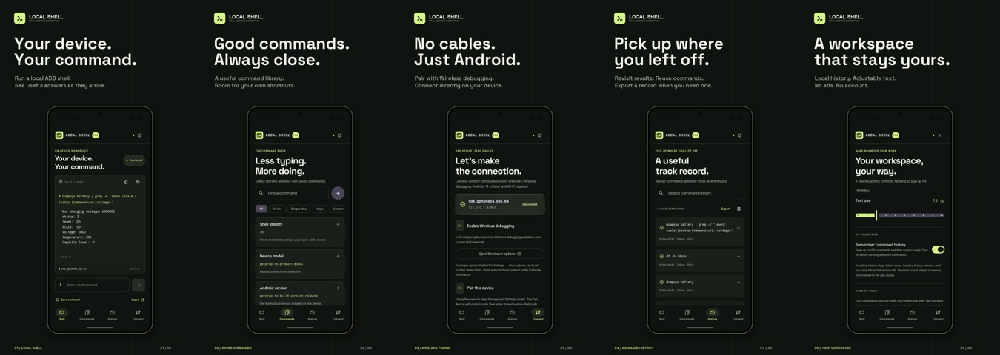

# ADB Local Shell PRO

A native Kotlin / Jetpack Compose command workspace for Android. Direct local ADB pairing, shell output, saved commands and searchable history in a quiet charcoal-and-lime interface.



**Package:** `com.deploydulupulangnanti.adblocalshellpro`  
**Developer:** PT Deploy Dulu Pulang Nanti  
**Support:** seandyadryan2@gmail.com

## Requirements

- Android 11+ (API 30), Wi-Fi and manufacturer support for Wireless debugging.
- JDK 17+ for development; Android SDK 36, NDK 28.2.13676358 and CMake 3.22.1; Gradle wrapper included.
- No root, Shizuku, account or external ADB binary is required in the app.

## Connect

1. Enable Developer options, then Wireless debugging. Authorize your Wi-Fi network.
2. Keep Settings and this app visible in split screen. Open **Pair device with pairing code**. Copy its pairing port and six-digit code into Connect → Pair this device.
3. Return to the **main** Wireless debugging page. Enter the **connection** port shown under IP address & Port. It differs from the pairing port.
4. Connect and run `id` to verify access. After reboot or toggling Wireless debugging, the connection port may change.

The client only connects to `127.0.0.1`. Manufacturer restrictions, VPNs and device configuration may affect pairing. Disable Wireless debugging when finished.

## Build locally

Create `local.properties` with your Android SDK path. Copy `keystore.properties.example` to `keystore.properties` and supply signing credentials locally.

```powershell
.\gradlew.bat testDebugUnitTest lintRelease assembleDebug bundleRelease assembleRelease
```

Linux/macOS: use `./gradlew`. Release packaging fails explicitly if signing credentials are absent. Credentials and keystores are excluded from Git. Back up the signing keystore securely; the repository does not contain it.

Outputs: `app/build/outputs/apk/release/app-release.apk` and `app/build/outputs/bundle/release/app-release.aab`. Upload the **AAB** to Play Console; use the APK for installation checks. Build outputs are not committed.

## GitHub runner

The **Build signed Android release** workflow is **manual only** (`workflow_dispatch`). Pushes, commits and PRs do not trigger it. It uses one GitHub-hosted Ubuntu runner, Gradle caching, a 25-minute timeout and short artifact retention. No paid self-hosted runner is required.

Required repository Actions secrets:

- `KEYSTORE_BASE64` — base64-encoded signing keystore
- `KEYSTORE_PASSWORD`
- `KEY_ALIAS`
- `KEY_PASSWORD`

Optional: `GRADLE_ENCRYPTION_KEY` for encrypted configuration cache entries. This project does not enable configuration cache by default.

The workflow tests, runs release lint, builds signed APK/AAB, uploads artifacts and optionally deploys `docs/index.html` to GitHub Pages. Configure Pages with **GitHub Actions** as its source. The key is decoded only on the ephemeral runner and removed in an always-run cleanup step. Retrieve release files from the workflow's artifacts before they expire.

## Application behavior

- Direct ADB shell user access, without root. No automatic privileged changes.
- Non-interactive, separate shell for every command. Use `cd /path && command` within a single command. No persistent environment or full-screen terminal programs.
- Streaming stdout/stderr with UTF-8 packet handling, exit status, stop and export.
- Commands are attempted once; a transport failure never automatically replays a command. The pinned Kadb adapter selects its no-retry OPEN path.
- Two-minute command timeout and 1 MB total output limit; latest 64 KB displayed.
- Ten starter commands, search, categories and up to 100 custom commands.
- Optional history: latest 100 records, up to 16 KB output per entry. Disable future saves or clear existing history.
- Private installation-specific ADB identity; backup disabled; no analytics, advertising, billing or telemetry SDK.
- Responsive navigation rail and side panel on wide windows. Android desktop/tablet mode, not a Windows executable.

Some recognized modifying commands request additional review. This is a convenience, not a comprehensive shell-language security boundary. Review all commands yourself. Stop closes the shell stream; it does not roll back completed changes or guarantee termination of background processes started by a command. Commands you choose can themselves invoke Android network tools.

## Tests and captures

```powershell
.\gradlew.bat testDebugUnitTest connectedDebugAndroidTest
```

Core tests cover input boundaries and every UTF-8 split boundary. Instrumentation checks navigation and saving/loading a command without executing it. Optional integration tests use explicit instrumentation arguments:

- `LocalAdbTest`: `liveAdb=true`, `connectPort`, with an already authorized isolated emulator transport (defaults to port 5555).
- `WirelessAdbTest`: `pairPort`, `pairCode`, `connectPort`, with the system pairing dialog open.
- `EmulatorWirelessTest`: `wirelessFixture=true`, secure emulator only. Delegated shell permissions configure the Android system pairing service, then are dropped before the production client pairs and executes commands. The test reports the paired TLS connection port.
- `StoreCaptureTest`: `captureStore=true`, `connectPort`, `capturePrefix`; captures real UI after executing live diagnostic commands. Skipped in ordinary test runs.

Capture tooling: `tools/device_qa.py`. Artwork/video tooling: `tools/create_store_assets.py`. See `store/README.md` for dimensions, provenance and regeneration. Source captures are included in `store/raw/`.

## Play Store package

English listing copy, icon, 1024×500 feature graphic, phone/tablet/desktop artwork and MP4 video are in `store/`. Privacy HTML is `docs/index.html`; the same policy is available offline in the app.

See [Play publication notes](store/PLAY_CONSOLE.md). Set the app's price in Play Console. There is no in-app billing because this is intended as a paid download. Store submission, content declarations, testing requirements and approval remain with the account owner.

## Ownership and dependencies

Original application code and artwork: © 2026 PT Deploy Dulu Pulang Nanti. All rights reserved, subject to the LGPL relinking permissions in `LICENSE`. The source-included native SPAKE2 module is LGPL-3.0; complete library source, notices and rebuilding instructions are included in `pairing-native/`. Other dependencies retain their respective licenses; see `THIRD_PARTY_NOTICES.md` and in-app licenses. The pairing protocol adapter is attributed to its upstream Apache-licensed implementation.
